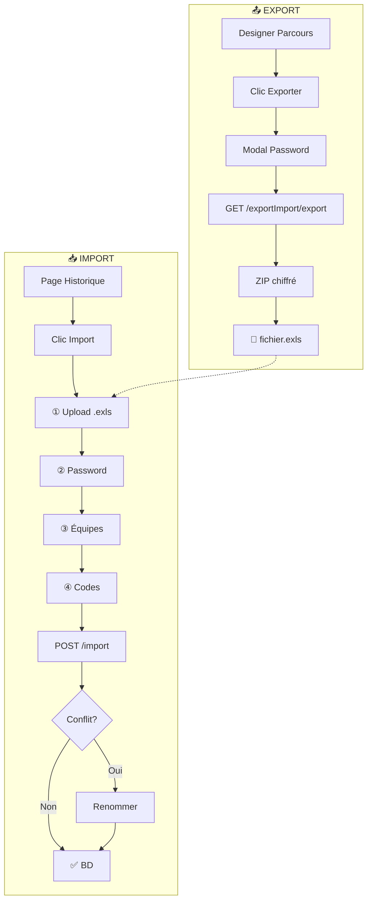

# Feature: Explain Mode (Animated Diagrams)

## Objectif

Transformer un diagramme Mermaid en animation explicative avec narration TTS.

---

## Use Case Test : Export/Import Hoppen



---

## Spec Technique

### 1. Parser Mermaid → AST

```typescript
interface DiagramNode {
  id: string
  label: string
  type: 'node' | 'decision' | 'subgraph'
}

interface DiagramEdge {
  from: string
  to: string
  label?: string
  style: 'solid' | 'dashed'
}

interface Diagram {
  nodes: DiagramNode[]
  edges: DiagramEdge[]
  subgraphs: { id: string, label: string, nodes: string[] }[]
}
```

### 2. Animation Sequencer

```typescript
interface AnimationStep {
  type: 'appear' | 'highlight' | 'connect' | 'fade'
  target: string | string[]
  duration: number
  narration?: string  // texte pour TTS
}

// Génération auto des steps depuis le diagram
function generateSteps(diagram: Diagram): AnimationStep[]
```

### 3. Renderer (Canvas/SVG)

- Utiliser `@mermaid-js/mermaid` pour le parsing
- Renderer custom pour l'animation (pas le rendu statique de mermaid)
- Smooth transitions avec `framer-motion` ou CSS animations

### 4. TTS Integration

- Réutiliser `TextToSpeech.jsx` existant
- Sync narration avec les steps d'animation
- Option: générer avec ElevenLabs API pour voix plus naturelle

### 5. Export Vidéo

- `MediaRecorder` API pour capturer le canvas
- Export WebM/MP4
- Option GIF pour partage rapide

---

## UI/UX

```
┌─────────────────────────────────────────────────┐
│  [▶ Play] [⏸ Pause] [⏮ Reset]  Speed: [1x ▼]  │
├─────────────────────────────────────────────────┤
│                                                 │
│            ┌─────────────┐                      │
│            │  Animated   │                      │
│            │  Diagram    │                      │
│            │  Canvas     │                      │
│            └─────────────┘                      │
│                                                 │
├─────────────────────────────────────────────────┤
│  Step 3/12: "Le fichier .exls est uploadé"     │
│  ████████████░░░░░░░░░░░░░░░░░░░░  25%         │
└─────────────────────────────────────────────────┘
```

---

## Roadmap (MVP)

- [ ] Parser Mermaid → structure interne
- [ ] Renderer SVG basique (nodes + edges)
- [ ] Animation appear/connect step-by-step
- [ ] UI controls (play/pause/step/speed)

~~- [ ] Intégration TTS~~ (pas nécessaire)
~~- [ ] Export vidéo~~ (pas nécessaire)
~~- [ ] Génération auto narration~~ (pas nécessaire)

**But : Comprendre visuellement un flux, pas produire une vidéo.**

---

## Dépendances à ajouter

```json
{
  "mermaid": "^10.x",
  "framer-motion": "^11.x"
}
```
