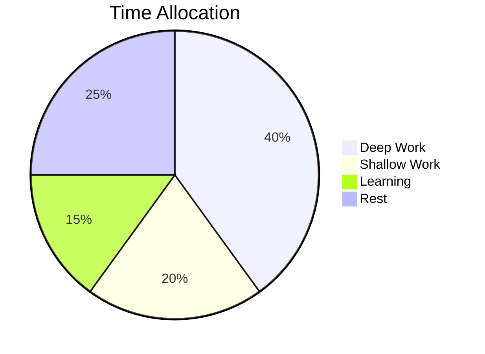

# The Art of Deep Work

> "The ability to perform deep work is becoming increasingly rare and increasingly valuable." (Cal Newport)

## Introduction

In our hyperconnected world, the ability to focus without distraction is a **superpower**. This guide explores strategies for cultivating deep work habits.

## Key Principles

### 1. Work Deeply
Create rituals and routines that minimize the need for willpower:

- **Time blocking**: Schedule deep work sessions
- **Shutdown ritual**: End each day with a clear stop
- **Environment design**: Dedicate spaces to focus

### 2. Embrace Boredom
Train your brain to resist distraction:

| Strategy | Difficulty | Impact |
|----------|-----------|--------|
| No-phone walks | Easy | High |
| Productive meditation | Medium | Very High |
| Memory training | Hard | Medium |

### 3. Quit Social Media

Apply the **craftsman approach**: adopt a tool only if its positive impacts substantially outweigh negatives.

## Code Example

```python
def pomodoro_timer(minutes=25):
    """Simple focus timer"""
    import time
    print(f"🍅 Focus for {minutes} minutes")
    time.sleep(minutes * 60)
    print("✅ Break time!")
```

## Daily Schedule



## Music for Focus

Here's a simple melody to help concentrate:

```abc
X:1
T:Focus Theme
M:4/4
K:C
|: C2 E2 G4 | A2 G2 E4 | F2 A2 c4 | B2 A2 G4 :|
```

## Summary

1. Schedule every minute of your day
2. Quantify the depth of each activity
3. Finish work by 5:30 PM
4. Become hard to reach

---

*"I'll live the focused life, because it's the best kind there is." (Winifred Gallagher)*
